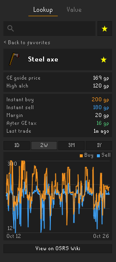

# GE Price Tracker

A clean, responsive [RuneLite](https://runelite.net) plugin for checking Grand Exchange prices, inspecting item price history graphs, and tracking inventory and bank wealth in real time.

---

## Features

| 🔍 Item Lookup | 📊 Item Details | ⭐ Favorite Items | 💰 Net Worth & Valuation |
| :---:|:---:|:---:|:---:|
|  |  |  |  |
| *Search items & guide prices* | *Live prices, margins & graphs* | *1-click access to pinned items* | *Live inventory, bank & wealth* |

### 1. Item Lookup
- **Instant Search:** Autocomplete search across all tradeable items with high-resolution icons, names, and guide prices.
- **Star to Favorite:** Click the star (★ / ☆) on any item in search results to immediately save it to your favorites.

### 2. Item Details & Price Graphs
- **Comprehensive Prices:** Displays the official Grand Exchange guide price alongside the High Alchemy value.
- **Live Wiki Buy & Sell:** Real-time instant buy and instant sell quotes from the OSRS Wiki.
- **Tax-Adjusted Flip Margins:** Automatically computes raw flip margin and profit after the 1% GE tax.
- **Interactive Price History Graph:** Toggle between **1 Day**, **2 Weeks**, **3 Months**, and **1 Year** intervals to analyze market trends.
- **Quick Links:** One-click button to view the item's live trading page directly on the OSRS Wiki.
- **Header Favorite Toggle:** Pin or unpin the item directly from the detail view header.

### 3. Favorite Items
- **Instant Quick Access:** Click the star button (`★`) beside the search bar to jump straight to your favorites list at any time.
- **Default View:** Whenever the search bar is empty, your favorites are automatically displayed for zero-click convenience.
- **Persistent Storage:** Saved safely into your RuneLite profile so your list stays intact across sessions.

### 4. Value Tab (Net Worth & Valuation)
- **Live Inventory Value:** Real-time net worth of items in your bag.
- **Bank Value:** Calculated automatically when opening your bank.
- **Combined Total:** Total account value across inventory and bank.
- **Top Items:** Quick breakdown of your most valuable possessions.

---

## Live Wiki Prices & Privacy

Real-time price quotes and historical charts are powered by the official [OSRS Wiki real-time prices API](https://prices.runescape.wiki/).

> [!NOTE]  
> **Disabled by default:** This feature connects to an external, third-party server. You can enable it anytime in the plugin configuration.

---

## Configuration

<p align="center">
  
</p>

| Setting | Default | Description |
|---|---|---|
| **Live Wiki prices & history** | `Disabled` | Fetch real-time buy/sell prices, margins, and history graphs from the OSRS Wiki API. |
| **Default graph range** | `2W` | Default timeframe shown on the item price history graph (1D, 2W, 3M, 1Y). |
| **Top items shown** | `10` | Number of top valuable items displayed in the Value tab (1–20). |

---

## Running in Development

Run with the included development launcher:
```powershell
.\run-dev.bat
```

Or build with Gradle:
```powershell
.\gradlew.bat run
```

---

## License

This project is licensed under the BSD 2-Clause License - see the [LICENSE](LICENSE) file for details.
