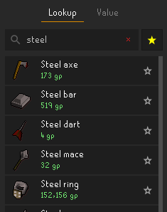
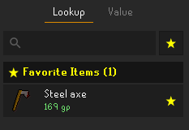
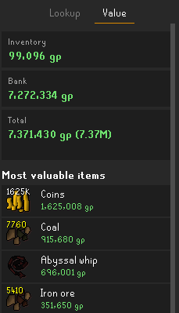
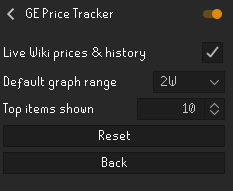

# GE Price Tracker

A clean, responsive [RuneLite](https://runelite.net) plugin for checking Grand Exchange prices, inspecting item price history graphs, and tracking inventory and bank wealth in real time.

---

## Features

| 🔍 Item Lookup | ⭐ Favorite Items | 💰 Net Worth & Valuation |
| :---:|:---:|:---:|
|  |  |  |
| *Search items, view prices, margins & star items* | *Instant 1-click access to pinned favorites* | *Live inventory, bank value & top items* |

### 1. Lookup & Favorites Tab
- **Quick Favorites:** Click the star (★) on any item in search results or detail view to pin it to your favorites.
- **Instant Access:** One-click access to your favorites via the top `★` button or whenever the search bar is empty.
- **Search Any Item:** Autocomplete search across all tradeable items with guide prices and High Alchemy values.
- **Live Wiki Prices & Margins:**
  - View real-time instant buy and instant sell prices.
  - Calculate tax-adjusted flip margins and ROI percentage.
  - Explore interactive price history graphs (`1D` / `2W` / `3M` / `1Y`).

### 2. Value Tab
- **Live Inventory Value:** Real-time net worth of items in your bag.
- **Bank Value:** Calculated automatically when opening your bank.
- **Combined Total:** Total account value across inventory and bank.
- **Top Items:** Quick breakdown of your most valuable possessions.

---

## Live Wiki Prices & Privacy

Real-time price quotes and historical charts are powered by the official [OSRS Wiki real-time prices API](https://prices.runescape.wiki/).

> [!NOTE]  
> **Disabled by default:** This feature connects to an external, third-party server. You can enable it anytime in the plugin configuration.

---

## Configuration

<p align="center">
  
</p>

| Setting | Default | Description |
|---|---|---|
| **Live Wiki prices & history** | `Disabled` | Fetch real-time buy/sell prices, margins, and history graphs from the OSRS Wiki API. |
| **Default graph range** | `2W` | Default timeframe shown on the item price history graph (1D, 2W, 3M, 1Y). |
| **Top items shown** | `10` | Number of top valuable items displayed in the Value tab (1–20). |

---

## Running in Development

Run with the included development launcher:
```powershell
.\run-dev.bat
```

Or build with Gradle:
```powershell
.\gradlew.bat run
```

---

## License

This project is licensed under the BSD 2-Clause License - see the [LICENSE](LICENSE) file for details.
